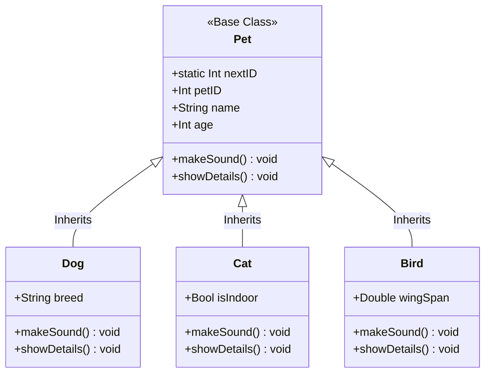

# Swift OOP: Pet Adoption & Management System

[](https://swift.org)
[](https://apple.com)
[](LICENSE)
[](Package.swift)

A modular Object-Oriented Command-Line Application demonstrating class inheritance, dynamic method overriding, runtime polymorphism, static state generation, and robust user input validation in Swift.

---

## 🚀 Key Competencies & Skills Demonstrated

- **Object-Oriented Architecture (OOP)**: Building hierarchical class structures with clean separation between base abstractions and specialized subclasses.
- **Inheritance & Super Initializers**: Delegating shared property initialization (`name`, `age`) to `super.init(...)` while configuring subclass-specific attributes (`breed`, `isIndoor`, `wingSpan`).
- **Dynamic Polymorphic Dispatch**: Iterating heterogenous collections (`[Pet]`) and invoking polymorphic methods (`makeSound()`, `showDetails()`) dynamically resolved at runtime.
- **Static Class State**: Implementing thread-safe auto-incrementing unique identifier tracking (`static var nextID`).
- **Defensive Input Validation & Sanitization**: Protecting CLI inputs using `guard` statements, whitespace trimming, and type-safe casting for positive numbers and boolean affirmations (`yes`/`y`/`no`/`n`).

---

## 🏛️ Class Hierarchy & Architecture



---

## 📂 Repository Structure

```tree
swift-oop-pet-adoption-system/
├── Sources/
│   ├── Pet.swift                # Base Pet class with static ID generator
│   ├── Dog.swift                # Subclass with breed property & dog sound overrides
│   ├── Cat.swift                # Subclass with indoor/outdoor state & cat sound overrides
│   ├── Bird.swift               # Subclass with wingSpan metric & bird sound overrides
│   └── main.swift               # Interactive CLI loop & defensive validation routines
├── PetAdoptionSystem.xcodeproj/ # Xcode project configuration
├── Package.swift                # Swift Package Manager manifest
├── .gitignore                   # Xcode / SPM exclusion rules
├── LICENSE                      # MIT Open Source License
└── README.md                    # Project documentation
```

---

## 🛡️ Input Validation Specifications

| Input Field | Validation Criteria | Error Handling Strategy |
| :--- | :--- | :--- |
| **Pet Name** | Non-empty after whitespace & newline trimming | Prompts re-entry with helpful hint |
| **Age** | Positive integer ($\ge 0$) parsed via `Int(trimmed)` | Rejects non-numeric/negative strings |
| **Wing Span** | Positive floating-point value ($> 0.0$) | Enforces valid dimensional measurement |
| **Indoor Status** | Case-insensitive boolean mapping (`yes`, `y`, `no`, `n`) | Validates binary answers explicitly |

---

## 💻 Interactive Terminal CLI Preview

```text
╔════════════════════════════════════════════╗
║    🐾 WELCOME TO THE PET ADOPTION CENTRE   ║
║     Your one-stop shop for finding pets!   ║
╚════════════════════════════════════════════╝

╔════════════════════════════════╗
║     🐾 PET ADOPTION CENTRE 🐾  ║
╚════════════════════════════════╝
1) 🐕 Create Dog
2) 🐱 Create Cat
3) 🐦 Create Bird
4) 📋 List All Pets
5) 🔊 Make All Pets Speak
6) 🚪 Exit
────────────────────────────────
📌 Enter choice (1-6): 1

🐕 CREATE A NEW DOG
────────────────────────────────
   📝 Dog name: Charlie
   📅 Age (in years): 3
   🏷️  Breed: Golden Retriever

   ✅ Dog added successfully! 🎉
   📌 Your new friend has been registered with ID: 1
```

---

## 🛠️ How to Run & Build

### Using Swift Package Manager (CLI)
```bash
# Build executable
swift build

# Run interactive system
swift run
```

### Using Xcode
1. Open `PetAdoptionSystem.xcodeproj` or open the directory in Xcode.
2. Select target `PetAdoptionSystem` and press `Cmd + R` to run in Xcode Terminal.

---

## 📄 License

This project is licensed under the [MIT License](LICENSE).
